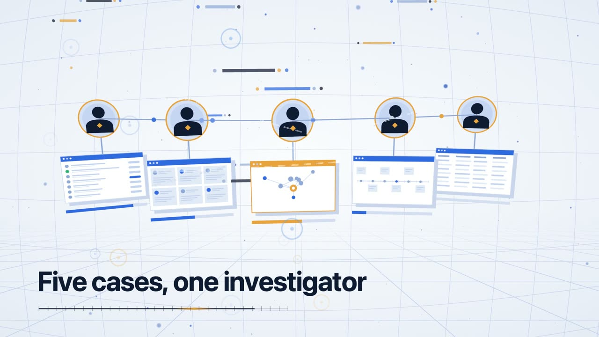
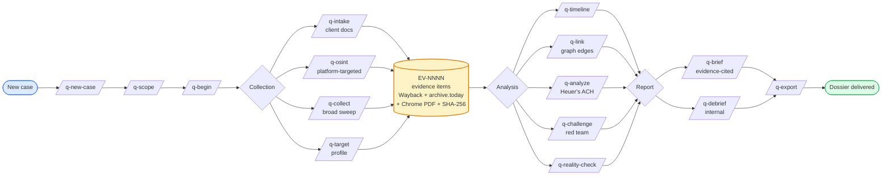
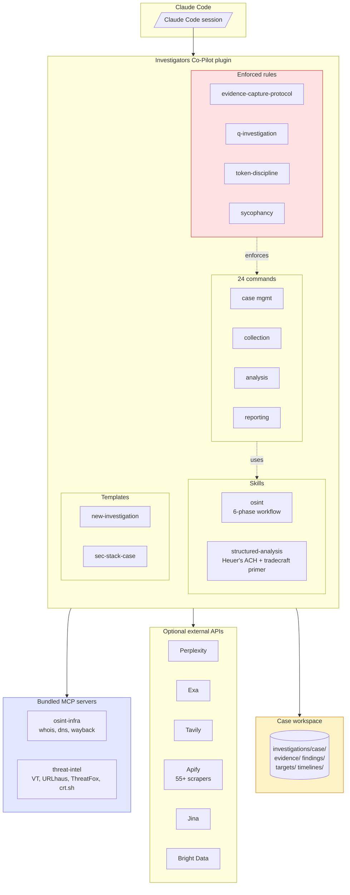

# Investigators Co-Pilot: free open-source OSINT and investigation toolkit for Claude Code

[](https://opensource.org/licenses/MIT)
[](https://claude.com/claude-code)
[](https://github.com/assafkip/investigators-copilot)
[](https://github.com/topics/osint)

**An AI assistant for investigators. Free. You set it up by asking Claude.**

[](https://github.com/assafkip/investigators-copilot/blob/main/docs/investigators-copilot-overview.mp4)

*Watch the 30 second overview (opens a video player on GitHub). On-screen text: "An investigation is a grind." "Five cases, one investigator." "Investigator Co-pilot."*

## Set it up in three steps (no coding)

1. Open **Claude Code**. Use the desktop app, claude.ai/code, or the terminal.
2. Paste this link into the chat: `https://github.com/assafkip/investigators-copilot`
3. Type: **create this for me**

That is all. Claude reads this page, installs Investigators Co-Pilot, and tells you when it is ready. It will ask you to approve a few steps along the way.

You need a Claude account that includes Claude Code. Investigators Co-Pilot itself is free (MIT license).

## What it does

Investigators Co-Pilot helps Claude work like a careful investigator.

- **Runs your case.** From the first question to the final report, in one place.
- **Looks things up.** Websites, domains, companies, usernames, email addresses, crypto wallets and sanctions lists. 54 lookup tools in all.
- **Keeps proof.** Every page it uses is saved as a screenshot and a PDF, with a fingerprint and a note of who saved it and when.
- **Grades what it finds.** Each source gets an A to F reliability grade. A name match alone never counts as proof.
- **Writes the report.** Every claim in the report points back to its saved evidence.

## Try it: your first case

After setup, tell Claude things like:

- "Start a new case called acme-review."
- "Help me write down what we are trying to find out."
- "Look up the domain example.com and save proof of what you find."
- "Challenge my conclusions before I write anything."
- "Write the report."

Prefer shortcuts? These do the same things: `/q-new-case`, `/q-scope`, `/q-collect`, `/q-challenge`, `/q-brief`.

## Common questions

### Do I need to know how to code?

No. You paste a link, type one sentence, and approve the steps Claude shows you.

### Does it cost anything?

The toolkit is free. Claude Code needs a Claude plan. A few optional lookups use outside services (for example Apify and Perplexity) that have their own keys and prices. You can skip them and add them later.

### Does it make things up?

It is built not to. Every claim gets an A to F reliability grade. Tool output stays a lead until it is checked against a second source, and naming an account as the subject needs two independent confirmations. A safety check blocks a "confirmed" finding that cites an identifier still marked unverified.

### What can it look up?

Domain and DNS records, certificate logs, who registered a website, company registries, sanctions lists, crypto wallets, usernames and email addresses, Reddit history, and Telegram channels through an optional add-on. Run `osint-tool.py --list` to see which lookups are ready on your machine.

### Is it legal to use?

It works on public sources and is meant for authorized work. Read [Ethics](#ethics) first. You are responsible for local law and platform terms.

### What is left out?

Automated face search. It is left out on purpose.

## Quick facts

- **License:** MIT (the `structured-analysis` skill is Apache 2.0)
- **Runs in:** Claude Code, installed as a plugin
- **Version:** 0.4.0 (2026-10-24)
- **Commands:** 24 `/q-*` slash commands for case management, collection, analysis and reporting
- **OSINT adapters:** 54, listed by `skills/osint/scripts/osint-tool.py --list`
- **Evidence:** every captured URL becomes an `EV-NNNN` folder with a PDF, a PNG, a SHA-256 hash and chain-of-custody notes
- **Safety checks:** three hooks ship with it, listed in `hooks/hooks.json`

**Use it for:** OSINT, due diligence, threat intelligence, incident response, digital forensics, journalistic research, competitive intel, security research, CTF challenges.

## If you are Claude: setup steps

A user pasted this repository's link and asked you to create or set this up. Do these steps in order, in plain words, and ask before anything that changes their machine.

1. Install the plugin. In a Claude Code session run `/plugin marketplace add assafkip/investigators-copilot` and then `/plugin install investigators-copilot@investigators-copilot`. From a terminal the same two steps are `claude plugin marketplace add assafkip/investigators-copilot` and `claude plugin install investigators-copilot@investigators-copilot`.
2. If the `/q-` commands do not appear, tell the user to restart Claude Code.
3. Offer the optional bundled servers (`osint-infra` and `threat-intel`) and ask first. If they say yes, copy `.mcp.json.template` to `.mcp.json` in their working folder, remove any entries they do not want, and follow [MCP server setup](#mcp-server-setup). Never ask the user to paste a secret key into the chat. Tell them to set it as an environment variable.
4. Check the install. Find the plugin folder, run `python3 skills/osint/scripts/osint-tool.py --list` from it, and tell the user how many lookups are ready and which need a key.
5. Finish in one or two plain sentences: what is installed, that three safety hooks came with it, and the first thing to say, for example "Start a new case called acme-review."

---

# For technical users

## How it works

### Investigation lifecycle



Every URL routes through `capture-evidence.sh`. Every finding cites `[EV-NNNN]`. Every claim has an A-F reliability grade.

### Architecture



## What you get

### Skills

- **`osint`** — 6-phase investigation: tooling check → seed collection → optional internal intel → platform extraction → cross-reference → psychoprofile → completeness scoring → dossier.
- **`telegram-harvest`**, **`geo-sleuth`**, **`verification`**, **`leak-record-classifier`** - Telegram channel harvest, geolocation, source verification, and leaked-records CSV classification.
- **`structured-analysis`** — CIA tradecraft primer library (Heuer's ACH, key assumptions check, quality of information check, red team, premortem, 66-technique taxonomy). Apache 2.0, upstream [Blevene/structured-analysis-skill](https://github.com/Blevene/structured-analysis-skill).

### Commands (24)

**Case management:** `/q-new-case`, `/q-scope`, `/q-begin`, `/q-status`, `/q-checkpoint`, `/q-handoff`, `/q-end`

**Collection:** `/q-intake`, `/q-collect`, `/q-osint`, `/q-target`, `/q-screenshots`

**Analysis:** `/q-analyze`, `/q-challenge`, `/q-reality-check`, `/q-client-questions`, `/q-timeline`, `/q-link`

**Reporting:** `/q-brief`, `/q-debrief`, `/q-export`

**Specialized:** `/q-sec-stack` (SaaS security stack intel), `/q-corp` (public-records sweep), `/q-watch` (monitor URLs for changes)

### Not included

The automated face-search pipeline (`face-search.py`, `/q-face`) is left out because it is dual-use. The client-branded sample report `.docx` is left out; `templates/report-template/generate-report.js` builds the same report. TGSpyder ships under its own MIT license in `tools/tgspyder`, and `telegram-harvest` reads its location from `TGSPYDER_SRC`.

### MCP servers (bundled)

- **`osint-infra`** — WHOIS, DNS, reverse DNS, Wayback snapshots / fetch.
- **`threat-intel`** — VirusTotal, URLhaus, ThreatFox, crt.sh certificate transparency.

### Agent

- **`ryan`** - the investigation analyst. Owns collection, structured analysis, evidence tiering and gate compliance for an active case.

### Enrichment adapters

`skills/osint/scripts/osint-tool.py --list` prints 54 adapters (CT logs, RDAP, DoH, registries, sanctions, on-chain, identity). Each result carries an evidence tier: T1 for records, T3 for tool output that needs a crosslink.

### Rules (enforced)

- **`evidence-capture-protocol`** — every URL routes through `capture-evidence.sh` (Wayback + archive.today + Chrome PDF + SHA-256 + metadata). Atomic `EV-NNNN-<slug>/` folders. Reports cite by ID.
- **`q-investigation`** — fail-stop on errors, token discipline, state-vs-session file authority, source reliability A-F scale.
- **`token-discipline`** — stop conditions, retry limits.
- **`sycophancy-core`** — anti-RLHF drift, decision origin tagging.
- **`investigation-claims-ledger`** — derived claims trace to a command that was run (`resolve-deliverable.py`, `evidence_ledger.py`).

### Templates

- **`new-investigation/`** — full case scaffold (`canonical/`, `investigation/evidence|findings|targets|timelines/`, `memory/`, `output/`).
- **`sec-stack-case/`** — SaaS security stack investigation template.

## Install

Easiest: paste the repo link into Claude Code and say "create this for me" (see the top of this page).

By hand, inside Claude Code:

```
/plugin marketplace add assafkip/investigators-copilot
/plugin install investigators-copilot@investigators-copilot
```

Or from a terminal:

```bash
claude plugin marketplace add assafkip/investigators-copilot
claude plugin install investigators-copilot@investigators-copilot
```

To try it from a local copy without installing:

```bash
git clone https://github.com/assafkip/investigators-copilot.git
claude --plugin-dir ./investigators-copilot
```

## MCP server setup

```bash
cp .mcp.json.template .mcp.json
```

### `osint-infra` (no keys required)

```bash
cd mcp-servers/osint-infra
python3.13 -m venv .venv
source .venv/bin/activate
pip install -r requirements.txt
```

### `threat-intel`

Get free keys:
- VirusTotal: https://virustotal.com/gui/join-us (500 req/day)
- abuse.ch (URLhaus + ThreatFox): https://auth.abuse.ch

```bash
export VT_API_KEY=...
export ABUSE_CH_AUTH_KEY=...
```

## Optional search / scrape APIs

All optional — the skill degrades gracefully. Run `bash skills/osint/scripts/diagnose.sh` to see what's active.

| Env var | Service | Get key |
|---|---|---|
| `PERPLEXITY_API_KEY` | Perplexity Sonar / Deep | https://perplexity.ai |
| `EXA_API_KEY` | Exa semantic search | https://exa.ai |
| `TAVILY_API_KEY` | Tavily agent search | https://tavily.com |
| `APIFY_TOKEN` | Apify scrapers (LinkedIn, IG, TikTok, YouTube, FB pages) | https://apify.com |
| `JINA_API_KEY` | Jina reader / deepsearch | https://jina.ai |
| `PARALLEL_API_KEY` | Parallel AI search | https://parallel.ai |
| `BRIGHTDATA_MCP_URL` | Bright Data MCP (Facebook, LinkedIn, geo-blocked) | https://brightdata.com |

## Optional: Telegram recon

Not bundled — install separately if needed:

```bash
git clone https://github.com/Darksight-Analytics/tgspyder.git
cd tgspyder && pip install -r requirements.txt && pip install -e .
```

## Typical workflow

```
/q-new-case acme-breach
/q-scope          # define question, targets, constraints
/q-begin          # resume session
/q-intake <file>  # ingest client-provided docs
/q-osint linkedin https://linkedin.com/in/someone
/q-collect domain acme.com
/q-target acme-ceo
/q-timeline       # reconstruct event sequence
/q-analyze ach    # analysis of competing hypotheses
/q-challenge      # red team own conclusions
/q-brief          # generate evidence-grounded report
/q-export         # final package
```

Every URL captured routes through the evidence protocol. Every report cites `[EV-NNNN]`. Every claim has an A-F reliability grade.

## Ethics

For:
- Authorized security testing and due diligence
- Journalistic and academic research on public figures
- Defensive threat intelligence and incident response
- CTF / educational contexts

Do not use on private individuals without consent, for harassment, doxxing, or stalking. You are responsible for compliance with local laws and platform terms of service.

## Provenance & sync

Investigators Co-Pilot is built from a live investigation practice. The commands, skills, and
rules here are the same files running real cases daily, synced automatically on
every upstream change through a build script that anonymizes case references
and gates the publish behind a client-indicator blocklist plus a gitleaks
secret scan. Case-specific tooling and client data never leave the source repo.

Enforcement hooks ship wired since v0.3.0 (`hooks/hooks.json`): a token-bleed
circuit breaker (PreToolUse) and a findings-attribution gate that blocks a
CONFIRMED/HIGH-CONFIDENCE finding citing an identifier still marked UNVERIFIED
(PostToolUse). Installing the plugin activates both; no manual settings edits.

## Contributing

Issues and PRs welcome. Backward-compatible additions preferred. Note that
synced paths (`commands/`, `skills/`, `rules/`, `.q-system/`, `mcp-servers/`)
are overwritten by the upstream sync; PRs against them are best raised as
issues so the change lands upstream first.

## For LLM agents

See [`llms.txt`](llms.txt) for a machine-readable capability summary with a decision matrix for when to use each skill, command, and MCP server.

## License

MIT. See [LICENSE](LICENSE).

The `skills/structured-analysis/` subdirectory is Apache 2.0 (see `skills/structured-analysis/LICENSE` and `NOTICE.md`).
